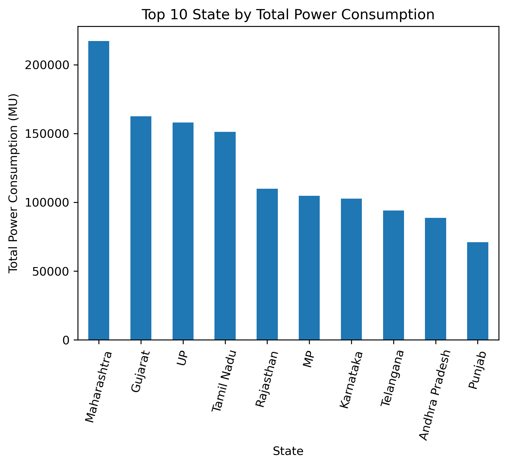
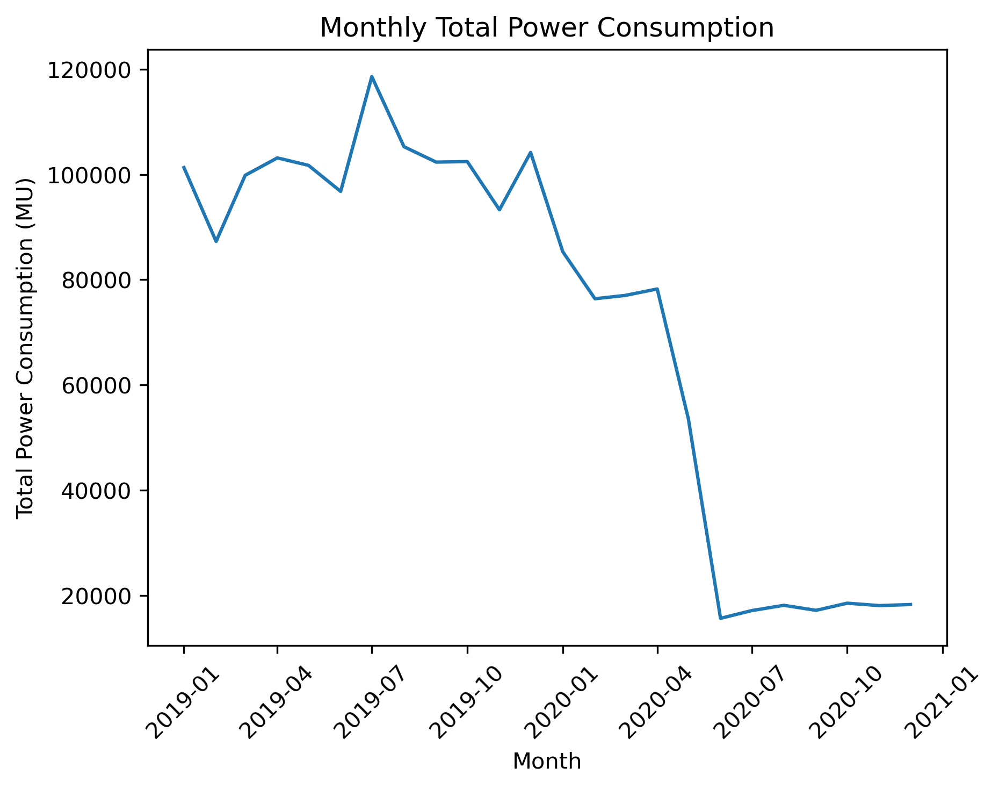
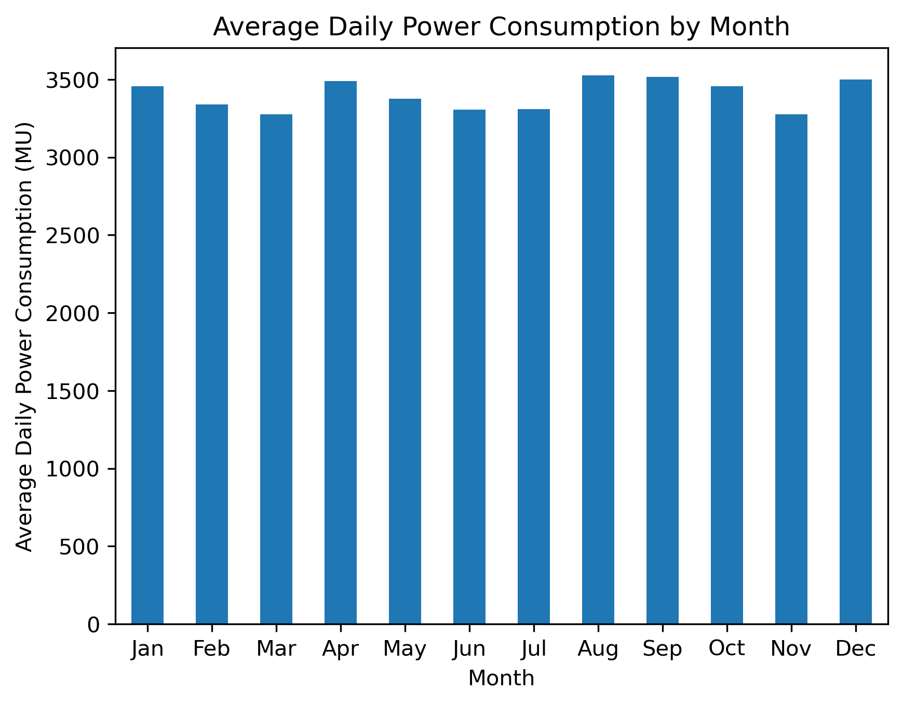
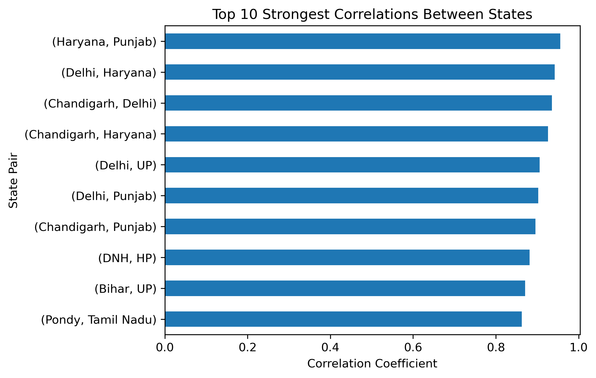
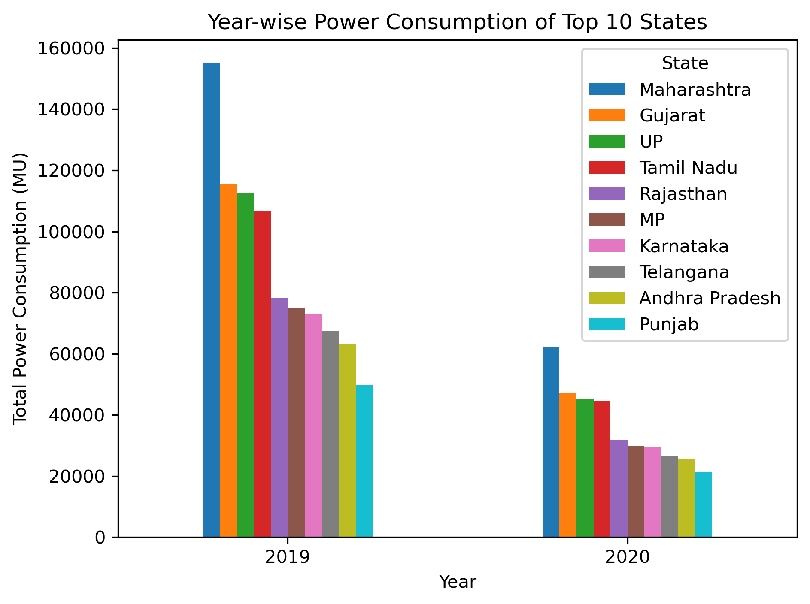

# State-wise Power Consumption Analysis in India


## 📌 Project Overview

This project analyzes state-wise electricity consumption in India using Python and data analysis techniques. The dataset contains daily power consumption records for different states over the available period.

The project focuses on understanding electricity consumption patterns, comparing consumption among states, analyzing monthly and yearly trends, and identifying relationships between the power consumption of different states.

## 🎯 Objectives

- Analyze daily electricity consumption across different states.
- Calculate total and average power consumption.
- Identify states with the highest and lowest consumption.
- Analyze monthly power consumption patterns.
- Compare power consumption across the available years.
- Identify the highest and lowest consumption dates.
- Analyze correlations between different states.
- Create visualizations to communicate important findings.
- Extract meaningful insights from the dataset.

## 🛠️ Technologies Used

- **Python**
- **Pandas**
- **NumPy**
- **Matplotlib**
- **Jupyter Notebook**

## 📂 Project Structure

```text
Electricity Analysis/
│
├── data/
│   └── dataset_tk.csv
│
├── analysis.ipynb
├── requirements.txt
├── README.md
└── LICENSE
```

## 📊 Analysis Performed

The project includes the following analyses:

1. Data loading and exploration
2. Data cleaning and preprocessing
3. Date conversion and feature extraction
4. Missing-value and duplicate checking
5. Statistical summary
6. Total daily power consumption
7. State-wise total consumption
8. Average power consumption
9. Highest and lowest consumption dates
10. Monthly average consumption
11. Monthly total consumption
12. State-wise average consumption
13. State-wise maximum consumption
14. State-wise minimum consumption
15. Year-wise power consumption
16. Correlation analysis between states
17. Top 10 correlated state pairs
18. Data visualizations and insights

## 📊 Visualizations

### 1. Top 10 States by Total Power Consumption

This visualization shows the top 10 states based on their total electricity consumption in the dataset.



---

### 2. Monthly Total Power Consumption

This visualization shows the total electricity consumption for each month across the available years.



---

### 3. Monthly Average Power Consumption

This visualization shows the average daily electricity consumption for each month across the dataset.



---

### 4. Top 10 Strongest State Correlations

This visualization shows the state pairs with the strongest positive relationships in their power consumption patterns.



---

### 5. Year-wise Power Consumption of Top 10 States

This visualization compares the total power consumption of the top 10 consuming states across the available years.



## 📈 Key Findings

- The average daily power consumption across all states was approximately **3399.06 MU**.
- The highest daily power consumption was recorded on **24 February 2019**, at approximately **4059.10 MU**.
- The lowest daily power consumption was recorded on **31 May 2019**, at approximately **2555.80 MU**.
- **Maharashtra** had the highest average power consumption among the states, followed by Gujarat and UP.
- Maharashtra also recorded the highest maximum power consumption.
- Sikkim, Arunachal Pradesh, and Mizoram were among the states with the lowest power consumption.
- **Haryana and Punjab** showed the strongest positive correlation, with a correlation coefficient of approximately **0.956**.
- Several other state pairs also showed strong positive relationships in their power consumption patterns.

> **Note:** The dataset contains only part of the year 2020. Therefore, 2020 totals should not be interpreted as complete-year consumption or directly compared with the complete 2019 year.

## 📌 Conclusion

The analysis demonstrates how Python-based data analysis and visualization can be used to understand electricity consumption patterns across different states in India.

The project identified differences in consumption levels between states, monthly consumption patterns, important high and low consumption periods, and strong relationships between the consumption patterns of several states.

Overall, the project provides useful insights into state-wise electricity consumption and demonstrates practical applications of data cleaning, statistical analysis, grouping, aggregation, correlation analysis, and data visualization.

## ▶️ How to Run the Project

### 1. Clone the repository

```bash
git clone <your-github-repository-url>
```

### 2. Open the project folder

```bash
cd electricity-analysis
```

### 3. Install the required libraries

```bash
pip install -r requirements.txt
```

### 4. Open the Jupyter Notebook

```bash
jupyter notebook
```

Then open `analysis.ipynb`.

## 📁 Dataset

The dataset is stored in the `data` folder and contains state-wise daily power consumption records.

## 👨‍💻 Author

**Ankit Rawat**

BCA Student  
DIT University, Dehradun
